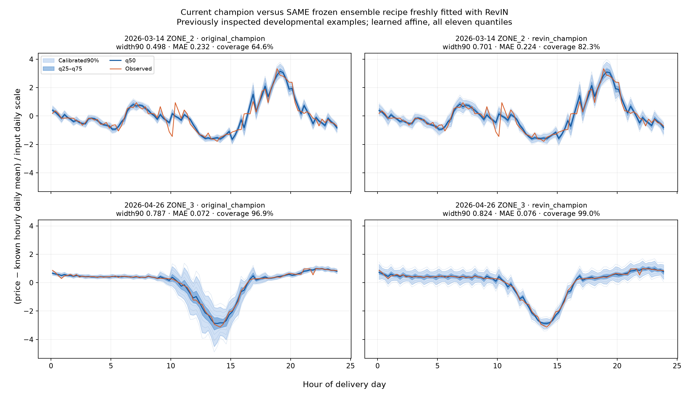

# AET quarter-hour electricity-price reconstruction

Reconstruct four quarter-hour prices from each supplied hourly mean, using the official data and strictly earlier quarter-hour history. Every reconstructed hour must retain its supplied mean within **0.0001 EUR/MWh**.

## Latest RevIN and uncertainty results

Eight developmental monthly folds; lower mean monthly MAE/interpolation MAE is better.

| Model | Original ratio | With RevIN |
| --- | ---: | ---: |
| Champion ensemble | **0.707968** | 0.725133 |
| Linear compact | **0.724553** | 0.733498 |
| Matched compact CNN | **0.768726** | 0.787509 |

RevIN produced wider intervals and higher aggregate coverage, but worsened point accuracy in these trials. The original research champion remains unchanged. The ensemble and linear trials preserve their source-selected recipes; the compact CNN uses a matched candidate comparison.



**Left:** original champion. **Right:** the same ensemble recipe freshly fitted with RevIN. All panels share normalized axes; orange is observed price, blue is q50, and shading shows raw q25–q75 and calibrated 90% intervals. These two previously inspected days illustrate behavior, not independent confirmation.

[Features, model explanations and all plots](docs/MODELS_AND_UNCERTAINTY.md) · [Champion RevIN report](results/champion_revin_20261017/REPORT.md) · [Linear compact RevIN report](results/linear_compact_revin_20261017/REPORT.md)

## Start here

1. [Current project context](project_memory.md): concise status and next step.
2. [Agent instructions](AGENTS.md): working rules for coding agents and other LLMs.
3. [Required validation](VALIDATION_PROTOCOL.md): authoritative protocol for new comparisons.
4. [Research champion](BEST_MODEL.md) and [complete ranking](MODEL_RANKING.md): audited development results.
5. [Running and reproducing the solution](docs/RUN_SOLUTION.md): training and inference details.

The research champion and the older all-history deployment refit are separate artifacts. September has been inspected during development; it is not a blind test. Model binaries and large recovery archives are excluded from Git, so cloning alone does not provide a fitted inference model.

## Layout

| Path | Purpose |
| --- | --- |
| `code/` | Shared model modules, training, evaluation, audits and plotting scripts |
| `campaigns/` | Experiment-specific implementations and provenance snapshots |
| `docs/` | Operating guides and [documentation index](docs/README.md) |
| `docs/protocols/` | Historical study protocols; required current validation stays at the root |
| `docs/reference/` | Original challenge instructions, preserved verbatim |
| `results/` | Saved metrics, manifests, figures and evidence grouped by study |
| `submission/` | Preserved, self-contained frozen deployment bundle |
| `memory/records/` | Detailed dated project history; may contain superseded decisions |
| `best_model.json` | Current research-model registry |
| `frozen_recipe.json`, `rolling_plan.json` | Preserved deployment/experiment configurations |
| `train_prices_15min.csv` | Official training input |

## Commands

Run from the repository root. Install the pinned dependencies in a dedicated environment:

```sh
python -m pip install -r requirements-catboost.txt
python run.py --help
python run.py predict_best --help
python run.py predict_best --selection results/deployment_best.json --hourly test_hourly.csv --history history_15min.csv --output predictions.csv
```

`run.py` resolves a script name from `code/`, sets the working directory and shared import path, and passes through arguments. It also supports campaign paths, for example `python run.py campaigns/basic/train_search.py --help`. Use this launcher for campaign scripts that import shared modules. Direct `python code/<script>.py` commands work from the root for ordinary scripts.

`python run.py rank_models` regenerates rankings from saved metrics without training. Substantial training, inference and evaluation belong on an authorized research server; do not launch them on a local laptop. Historical `run_*` scripts can contain old host/process assumptions: inspect them before reuse. Some campaigns verify original source hashes and root paths; reproducing those audits requires the original checkout and recorded environment, not a new run against relocated modules.

The [script index](docs/CODE_INDEX.md) and [layout migration map](docs/layout_migration.json) locate old paths. Historical evidence retains its original paths and hashes; do not rewrite it to make it look current.
