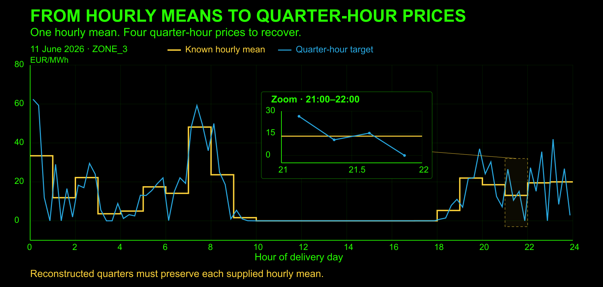
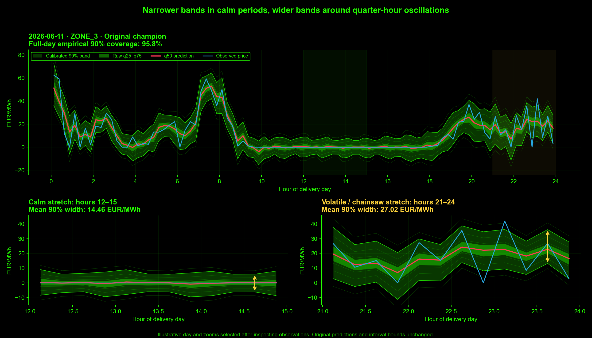

<div align="center">

# PhDs but not for long
### One hourly mean. Four quarter-hour prices to recover.

**AET Neural Wave 2026 · Electricity-price reconstruction · Four zones**

[Results](#results) · [How it works](#how-it-works) · [Uncertainty](#uncertainty-you-can-inspect) · [Run the solution](#run-the-solution) · [Submission materials](delivery/README.md)

</div>



Recover the shape hidden inside each hour while preserving its supplied mean. Our quantile ensemble combines the known four-zone hourly curves with strictly earlier observed quarter-hour history, then learns corrections to a mean-corrected interpolation baseline.

> **The constraint is part of the model:** every four-quarter point forecast retains its supplied hourly mean within **0.0001 EUR/MWh**.

## Results

| Less error than interpolation¹ | Pooled MAE | Calibrated 90% coverage² | Evaluation scope |
| :---: | :---: | :---: | :---: |
| **29.20%** | **4.103 EUR/MWh** | **90.59%** | **8 months · 4 zones · 92,544 targets** |

¹ Reduction from the **equal-month mean MAE / mean-corrected-interpolation MAE**, score **0.707968**. The champion beats interpolation in all eight evaluated months. Pooled MAE weights individual targets and is a separate statistic. ² Empirical aggregate coverage on the developmental folds; mean interval width **18.84 EUR/MWh**.

These are **February–September 2026 developmental backtests**, with fresh fitting and chronological selection/calibration. The winning recipe was identified after comparing developmental aggregates; September is not blind, and the folds share training history. Coverage is not a guarantee for future data.

[Champion card](BEST_MODEL.md) · [Complete ranking](MODEL_RANKING.md) · [Source metrics](results/minimize_expanding_20261017/summary.csv) · [Replay and constraint audit](results/minimize_expanding_20261017/audit.json)

## How it works

```text
Known four-zone hourly curves + strictly prior observed quarters
                              ↓
               Mean-corrected interpolation
                              ↓
          Learned within-hour shape corrections
               MLP · temporal CNN · analog CNN*
                              ↓
           Frozen blend + separate calibration
                              ↓
     Mean-preserving q50 + 11 quantiles + 50/80/90/95% intervals
```

The model learns **how prices move inside an hour**. Its point corrections sum to zero, so the hourly mean is retained by construction. Historical quarter-hour shapes and similar-day residuals supply context; current hourly ramps and cross-zone curves describe the day being reconstructed.

*The champion uses equal MLP/temporal-CNN/analog-2D-CNN weights from April through September. February uses rich linear + MLP; March averages six experts. Each fold’s recipe is selected using preceding-month data and frozen through its test month. See [exact fold recipes](results/model_ranking_20261017/champion_per_fold.json).

### Why combine experts?


Different experts can over- and undershoot the same quarter, letting a blend cancel some error. Averaging can also dilute a sharper expert forecast. These panels are **hindsight-selected extremes**, included to show both behaviors. Across the eight folds, cancellation reduces weighted member loss by **2.85%**; this does not imply beating the best expert on every hour.

[Completed interpretation and exact example values](results/interpretability_deep_20261017/REPORT.md) · [Features and model explanations](docs/MODELS_AND_UNCERTAINTY.md)

## Uncertainty you can inspect



**Same day, same zone, same price scale.** Red is the median forecast, blue is the observed price, and green shading shows raw q25–q75 and the calibrated 90% interval. Mean 90% width is **14.46 EUR/MWh** in the calm zoom and **27.02 EUR/MWh** in the volatile zoom.

This example was selected after inspecting observations to illustrate existing band behavior. Predictions and interval bounds are unchanged; it is not independent evidence of reliability. Width indicates relative uncertainty and can miss spikes. The figure shows the **original champion**, with no RevIN modification.

[Figure provenance and selection limits](results/illustrative_quantile_bands_20261017/REPORT.md) · [Saved quarter-level values](results/illustrative_quantile_bands_20261017/example_predictions.csv) · [RevIN comparison](results/champion_revin_20261017/REPORT.md)

## Validation that respects time

Every comparison follows the [required validation protocol](VALIDATION_PROTOCOL.md):

- **Fit from scratch** on expanding history starting in October 2025.
- **Select** on preceding-month days 1–15; **calibrate** on days 16–end.
- **Freeze** model parameters and calibration before the next full test month.
- **Use official data only** and strictly prior observed quarters. The supplied full-day hourly curves are known inputs.
- **Audit** finite ordered outputs, eleven quantiles and hourly-mean conservation for q50. Marginal interval endpoints need not preserve the hourly mean.

Rank by the arithmetic mean of eight monthly MAE/interpolation-MAE ratios. Retain raw MAE, per-zone results, pinball loss, interval widths and empirical coverage alongside that score.

**Final model frozen by the user on 17 October 2026.** Use `champion_348fit_15cal_20261017` (two MLPs, two temporal CNNs, two analog 2D CNNs; 1/6 each). No further training, refitting, tuning or recalibration. [Verified freeze receipt](CHAMPION_FREEZE.json).

## Run the solution

**A fitted model must be supplied separately.** Model binaries, prediction arrays and large recovery archives are excluded from Git; cloning the repository does not provide a fitted inference model.

Use the standalone **`champion_348fit_15cal_20261017`** archive with Linux/Python 3.12. From the extracted `champion_submission/` directory:

```sh
python3.12 -m venv .venv
source .venv/bin/activate
python -m pip install -r requirements.txt
python run.py --hourly /absolute/path/test_hourly.csv \
  --history /absolute/path/history_15min.csv \
  --output /absolute/path/predictions.csv
```

[Jury inference guide: unpacking, checksums, CSV formats and optional quantiles](delivery/RUN_FOR_JURY.md)

The champion archive has been recovered and checksum-verified locally; remote receipts confirm clean installation, isolated CPU replay and CSV checks. Final artifact distribution is pending. It fits 348 dates and reserves September 16–30 for calibration. The preserved `submission/` bundle is the older recipe. See the [refit specification](campaigns/submission_champion_20261017/README.md) and [research/deployment distinction](docs/SUBMISSION_REFIT_PLAN.md).

For repository scripts, run from the root through the launcher:

```sh
python run.py --help
python run.py predict_best --help
python run.py rank_models
```

`rank_models` regenerates rankings from saved metrics. Training, substantial inference and heavy evaluation run on authorized research servers. Campaign entry points use `python run.py campaigns/<study>/<script>.py [args]`; inspect historical scripts before reuse.

## Explore the repository

| Start here | What you will find |
| --- | --- |
| [Submission materials](delivery/README.md) | Report draft, video script, presentation outline, credits and final checklist |
| [Champion](BEST_MODEL.md) · [Ranking](MODEL_RANKING.md) · [Registry](best_model.json) | Research selection, scores and evidence pointers |
| [Documentation](docs/README.md) · [Script index](docs/CODE_INDEX.md) | Operating guides, implementations and study protocols |
| [`code/`](code/) · [`campaigns/`](campaigns/) | Shared modules and experiment-specific implementations |
| [`results/`](results/) | Metrics, figures, manifests and audit evidence |
| [`submission/`](submission/) | Preserved frozen deployment bundle and manifest |
| [Project context](project_memory.md) · [Agent instructions](AGENTS.md) | Current work, constraints and repository workflow |
| [`memory/records/`](memory/records/) | Dated research history, including superseded decisions |

### PhDs but not for long

| Member | Role |
| --- | --- |
| Daniel S. Vega | Paladin |
| Valentina Moretti | Qween |
| Riccardo Ghetti | Margrave |
| Miguel Nogales | Bard |

The team is preparing the report and video. Report review, video recording and final transfer are tracked in the [delivery checklist](delivery/CHECKLIST.md).
