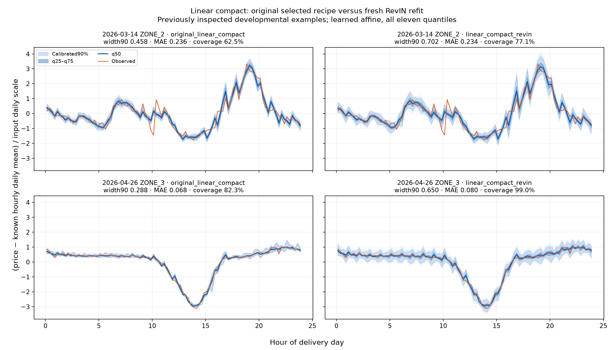
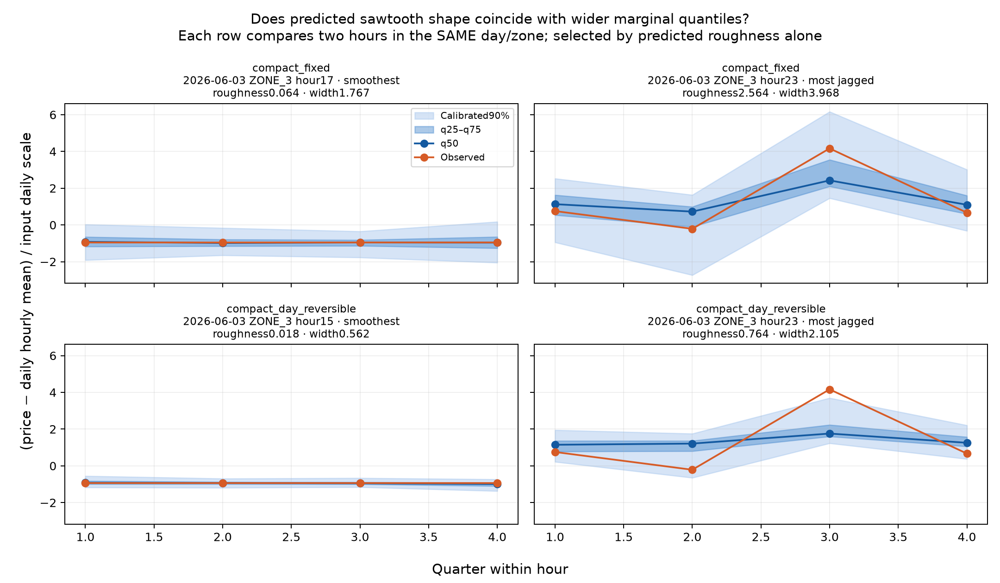

# Models, features and quantile uncertainty

Verified 17 October 2026. The task is quarter-hour reconstruction from supplied hourly means. The full day's hourly curves for all four zones are known. Current-day observed quarters are unavailable; only strictly earlier days' observed quarters may enter the inputs.

## Latest comparison

All entries use the eight expanding February–September developmental folds in [VALIDATION_PROTOCOL.md](../VALIDATION_PROTOCOL.md). The primary ratio is the arithmetic mean of each month's model MAE divided by that month's mean-corrected-interpolation MAE. Lower is better; these are not pooled ratios. September is not blind.

| Model | Original ratio | RevIN ratio | Original pooled MAE | RevIN pooled MAE | Original 90% coverage | RevIN 90% coverage |
| --- | ---: | ---: | ---: | ---: | ---: | ---: |
| Champion ensemble | 0.707968 | 0.725133 | 4.103184 | 4.206289 | 90.59% | 92.46% |
| Linear compact | 0.724553 | 0.733498 | 4.201780 | 4.254934 | 89.01% | 92.41% |
| Matched compact CNN | 0.768726 | 0.787509 | 4.456372 | 4.574789 | 89.70% | 91.27% |

MAE and original-currency widths use EUR/MWh. RevIN increased mean calibrated 90% width from 18.84 to 23.61 for the champion, 18.24 to 23.62 for linear compact, and 20.31 to 24.15 for the compact CNN. Higher coverage came with wider bands; it does not establish a better uncertainty model by itself. The original champion remains the best observed research recipe.

The champion trial refits its exact 51 selected components across eight folds. The linear-compact trial refits 15 selected checkpoints. Architectures, learning rates, seeds and averaging weights are frozen; stopping epochs use the preceding selection block. These are frozen-recipe transfer ablations, not complete new candidate searches. The compact CNN trial instead trains matched fixed/RevIN candidate grids. All three completed their independent replay, chronology, conservation and calibration audits.

Evidence: [champion summary](../results/champion_revin_20261017/summary.csv), [audit](../results/champion_revin_20261017/audit.json), [protocol](../campaigns/champion_revin_20261017/PROTOCOL.md); [linear-compact summary](../results/linear_compact_revin_20261017/summary.csv), [audit](../results/linear_compact_revin_20261017/audit.json), [protocol](../campaigns/linear_compact_revin_20261017/PROTOCOL.md); [compact CNN summary](../results/revin_quantiles_20261017/summary.csv), [audit](../results/revin_quantiles_20261017/audit.json).

## Full-day quantile bands: champion versus champion with RevIN

All panels share daily-normalized axes. Blue is the q50 decision, orange is observed price, dark shading is raw q25–q75, and light shading is the calibrated 90% interval. Thin lines show additional raw quantiles. Both columns use the same known hourly mean and scale for each example. The March 14 and April 26 dates were chosen in earlier development and fixed before these refits.

The March example includes observed spikes outside narrow bands; the drop example includes a known negative-price trough. The model already knows the hourly trough. Its uncertainty concerns the four quarters inside each hour. These panels do not establish that unfamiliarity caused wider bands.

[View the EUR/MWh version](../results/champion_revin_20261017/full_day_eur_mwh.png) · [Example predictions: all eleven quantiles](../results/champion_revin_20261017/example_predictions.csv) · [Detailed report](../results/champion_revin_20261017/REPORT.md)

## Linear compact: original versus RevIN

[EUR/MWh version](../results/linear_compact_revin_20261017/full_day_eur_mwh.png) · [All eleven quantiles and observations](../results/linear_compact_revin_20261017/example_predictions.csv) · [Detailed report](../results/linear_compact_revin_20261017/REPORT.md)

## The 194 linear-compact inputs

Each hour/zone gets the following features. The complete four-zone hourly curve is supplied input, including later hours of the same day.

| Group | Count | Contents |
| --- | ---: | --- |
| Current physical conditions and calendar | 18 | Current hourly price, left/right hourly slopes, daily mean/std, four same-hour zone differences, hour/weekday/year sine-cosine encodings and weekend flag |
| Prior quarter contrasts | 9 | Early-versus-late and within-half-hour contrasts from the previous day, previous week and previous-seven-day mean |
| Prior interpolation errors | 63 | Seven lags, each with four signed errors, four absolute errors and one availability flag |
| Historical analog corrections | 4 | Four quarter residual estimates retrieved from similar earlier hourly curves |
| Complete known hourly curves | 96 | Four zones times 24 hours |
| Zone indicators | 4 | One-hot zone identity |
| **Total** | **194** | Shared input layout for the compact-family experts |

Signed historical errors tell the model the direction in which interpolation previously missed. Absolute errors can help identify situations needing wider intervals. Availability flags distinguish missing history from an observed zero residual. The analog channels summarize earlier quarter patterns under similar hourly conditions; they do not fit a new model during inference.

Owning sources: [compact feature builder](../campaigns/monthly_ratio_20261017/sources/interpretable_models.py), [seven-day interpolation-error channels](../campaigns/monthly_ratio_20261017/sources/interpolation_history.py), [full compact/analog/curve assembly](../campaigns/monthly_ratio_20261017/experiment.py).

## How predictions preserve hourly means

First form mean-corrected interpolation from the known hourly curve. The compact linear model applies a shared affine head to the engineered inputs. Its three median coefficients, a/u/v, form four corrections:

`[a + u, a - u, -a + v, -a - v]`

Their sum is zero. After restoring physical units and adding the interpolation anchor, the predicted four-quarter mean still matches the supplied hour. Here a controls early versus late half-hour, u separates quarters 1/2, and v separates quarters 3/4. RevIN reverses its scale before adding the original physical anchor.

The head has 43 outputs: three median coefficients and 40 gap parameters (ten for each quarter). Positive transforms and cumulative sums construct five quantiles below q50 and five above it, ensuring ordering. The eleven levels are 0.025/0.05/0.10/0.20/0.25/0.50/0.75/0.80/0.90/0.95/0.975. Thus the feature-to-parameter head is linear, while the entire quantile construction is nonlinear. Only the q50 decision conserves the hourly mean; nonmedian marginal quantiles need not.

[Owning quantile model and training loss](../campaigns/monthly_quantiles_20261017/trainq.py).

## How the other experts work

| Expert | Mechanism |
| --- | --- |
| Linear rich | Same affine-head idea, with 389 more detailed curve, slope and causal-history features |
| Additive compact | Adds piecewise-linear hinge features, allowing effects to change at fitting-set quartile thresholds |
| MLP compact | Two hidden layers of 32 units learn nonlinear feature combinations |
| Temporal CNN rich | Two 16-channel convolutional layers with five-hour kernels process neighboring hours |
| Analog 2D CNN | Processes a joint-zone grid of past quarter/hour prices and known current hourly inputs, plus masks, clocks and causal analog channels |
| Champion ensemble | Convex averages of selected experts' quantile functions, including selected single-seed or seed-mean components |

The champion's original family/seed/blend selection uses the preceding first 15 days, then freezes for the next test month. [Exact champion fold recipes](../results/model_ranking_20261017/champion_per_fold.json). Quantile-function averages are not quantiles of a mixture distribution.

## What RevIN changes

For each supplied day/zone hourly curve, compute its mean mu and `s = sqrt(population variance + 1)`. Express current and strictly prior prices in daily-normalized coordinates. The small constant stabilizes nearly flat days. Preserve original causal analog retrieval choices, categorical/mask channels and existing absolute mean/std side features. Learn an additional positive affine scale and shift on monetary features, then reverse the scale on output residuals before restoring EUR/MWh and adding interpolation.

These trials adapt RevIN to constrained residual prediction; they do not claim exact replication of a published architecture. The champion/linear implementations add two shared affine parameters per expert. Their training loss stays in original currency with the original fitting-month ratio weights. Daily inverse-volatility weighting is used only for explicitly labeled diagnostics, not silently introduced into training.

## Do chainsaw patterns get wider bands?

This figure belongs to the earlier **compact CNN comparison**, not the champion or standalone linear compact. Each row compares two hours in the same day and zone. Examples are selected using predicted roughness, not observed error. Roughness is mean absolute second difference of the four q50 prices, divided by input-day scale; a linear segment has zero roughness.

Across the compact RevIN trial, calibration-defined chainsaw hours have normalized mean 90% width 0.725 versus 0.537 for smooth hours, about 35% wider. Their normalized MAE is 0.188 versus 0.079. The mean within-day rank correlation between roughness and width is 0.473. The fixed control also exhibits the relationship (correlation 0.498), so RevIN did not uniquely create it. Model-specific shape groups contain different hours and these descriptive values are not paired treatment effects.

[Shape summary](../results/revin_chainsaw_20261017/shape_summary.csv) · [Within-day associations](../results/revin_chainsaw_20261017/associations.json) · [Full diagnostic](../results/revin_chainsaw_20261017/REPORT.md).

Useful uncertainty should identify less predictable cases and achieve its stated coverage. A confidently predicted chainsaw can have narrow bands; a smooth median can hide several possible alternating trajectories. Marginal bands alone do not describe joint trajectory uncertainty or diagnose unfamiliarity. Occasional misses are expected even for a calibrated 90% interval; repeated conditional misses require checking group coverage.

## Validation, artifacts and execution

All model fitting and substantial feature processing ran on the authorized research GPU. Each fold fits from scratch, selects/stops on the preceding month's days 1–15, calibrates intervals on days 16–end, and tests on the next full month. Saved audits verify replay, causality, ordered finite outputs, hourly conservation and calibration calculations. Aggregate coverage is empirical developmental coverage, not a future or simultaneous-day guarantee.

Git contains code, protocols, lightweight metric/prediction exports and figures. Large checkpoints, full prediction arrays and recovery archives are excluded; cloning does not provide fitted models or all campaign caches. Archive locations, sizes and SHA256 receipts are recorded in each campaign's completion/manifest files. Reports preserve original remote paths; missing arrays must be restored from the owning archive before reproduction. The existing frozen deployment bundle is unchanged.

Use `python run.py campaigns/<study>/run.py` on an authorized research server after restoring required artifacts. Use `python run.py rank_models` for lightweight regeneration of the consolidated ranking. It does not fit models.
