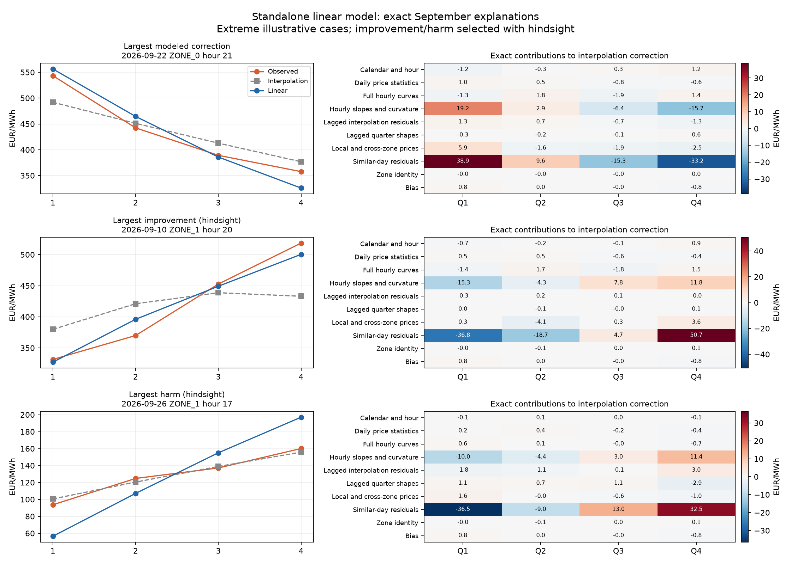
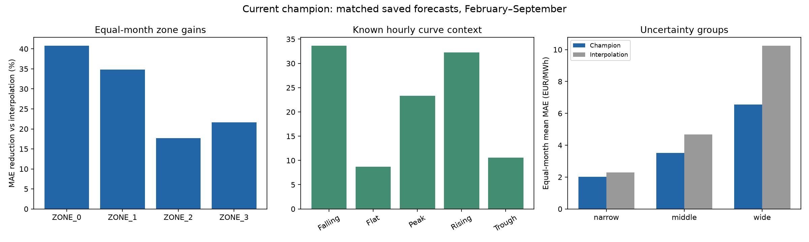
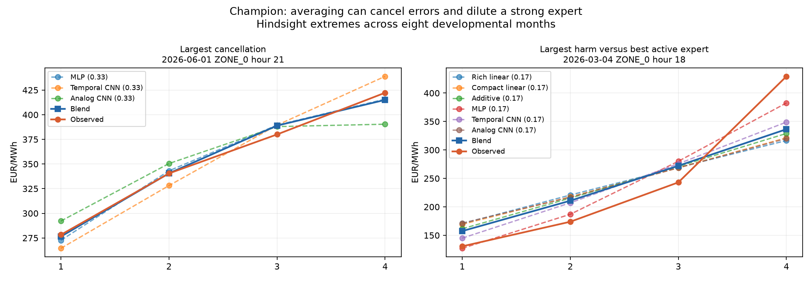

# Deeper interpretation of the linear model and current champion

Completed 17 October 2026 on authorized research server root@93.91.156.85:55340, `/workspace/HACKATON`. No training, recipe selection, submission replacement or classifier work. Nightwatch `9bdcaa1b892f8998f25b2959` delivered actual success, exit 0; log `/root/.local/share/nightwatch-hackaton/9bdcaa1b892f8998f25b2959.log`. Audit `audit.json`: standalone saved MAE replay difference 0; hourly mean error 5.68e-14 EUR/MWh; champion blend replay difference <=1.14e-13; eight-fold ratio matches registry.

## Interesting linear features

Scope: saved standalone ten-month linear-quantile model, tested on September. Exact contribution = clipped training-standardized input × quarter coefficient × output scale. Group contributions sum signed related features before averaging absolute magnitude across held-out quarters. They describe how this fitted model moves its forecast, not the MAE benefit of a feature or a causal effect.

| Feature group | Mean absolute net contribution, EUR/MWh |
|---|---:|
| Similar-day interpolation residuals | 3.410 |
| Hourly slopes and curvature | 2.055 |
| Local/cross-zone prices | 0.839 |
| Lagged interpolation residuals | 0.819 |
| Full hourly curves | 0.649 |
| Lagged quarter shapes | 0.426 |
| Daily price statistics | 0.322 |
| Calendar/hour | 0.267 |
| Zone identity | 0.039 |

The strongest individual feature contributions are analogous-history quarter 4/quarter 1 residuals, 1.551/1.510 EUR/MWh mean absolute contribution. Next include ZONE_0 price two hours earlier relative to target price (0.661), that earlier price itself (0.658), and ZONE_1 hour 04 price (0.613). Correlated price columns are redundant; interpreting a lone hourly-price coefficient as a physical mechanism would be unwarranted. The more reliable descriptive pattern is reliance on historical interpolation-error shape plus current ramps. Contributions can cancel; neither feature magnitudes nor group magnitudes are percentages summing to total prediction magnitude.

`linear_feature_contributions.csv` contains all 389 features; `linear_group_contributions.csv` includes per-zone summaries. No claim of coefficient stability across all eight fits; only one standalone JSON checkpoint was analyzed.

## Hierarchy

In physical EUR units, correction = `(a+u,a-u,-a+v,-a-v)`. Code outputs these contrasts in normalized units, then multiplies by 20. Half-hour correction averages are `(a,-a)`. Within-half differences are `2u` and `2v`. Positive a tilts toward the first half; negative a toward the second. Positive u favors Q1 over Q2; positive v favors Q3 over Q4. The signs are learned and may reverse.

Example with flat baseline `[100,100,100,100]`: a=4 gives half-hour averages 104/96; u=2,v=-1 gives quarters `[106,102,95,97]`, still mean 100. With a nonflat interpolation anchor, these are corrections added to its existing shape. The total forecast is itself hierarchical, but its total contrasts include both interpolation and learned terms. Four quarters subject to one mean constraint have three free shape coordinates, so this representation can express any zero-sum correction; it does not require a monotone quarter sequence.

## Exact individual explanations

Largest improvement (explicit hindsight selection), 2026-09-10 ZONE_1 hour 20: interpolation `[379.89,421.03,438.76,433.09]`, linear `[327.09,396.03,449.20,500.44]`, truth `[331.49,369.96,452.73,518.59]`. Similar-day residual contributions `[-36.8,-18.7,+4.7,+50.7]` sharpen a rising within-hour ramp; slopes add `[-15.3,-4.3,+7.8,+11.8]`. All groups plus bias reconstruct the correction exactly. Hour MAE falls from approximately49.74 to13.04 EUR/MWh.

Largest harm, 2026-09-26 ZONE_1 hour 17: interpolation `[100.57,120.46,138.88,155.81]`, linear `[56.48,107.10,155.05,197.09]`, truth `[93.70,124.77,137.15,160.10]`. Analog residuals plus slopes oversteepen the rise. The explanatory mechanism is visible in both a success and a failure; history matching can import a shape that is too strong. These are selected extremes, not representative estimates of frequency. All exact values, top features and grouped quarter contributions are saved in `linear_examples.json`; quarter predictions in `linear_examples.csv`.

## Zone differences

Champion conditional scores use all eight developmental folds and identical baseline targets. Raw pooled MAE and equal-month ratios answer different questions.

| Zone | Pooled champion MAE | Pooled interpolation MAE | Equal-month ratio | Best standalone family by descriptive aggregate |
|---|---:|---:|---:|---|
| ZONE_0 | 3.185 | 5.412 | 0.59194 | Compact linear (0.60722) |
| ZONE_1 | 4.678 | 7.159 | 0.65206 | Rich linear (0.66347) |
| ZONE_2 | 3.939 | 4.784 | 0.82272 | Analog CNN (0.82340) |
| ZONE_3 | 4.612 | 5.905 | 0.78327 | Compact linear (0.79085) |

ZONE_2 is not the largest absolute-error zone; it has a smaller relative improvement. The analog CNN is the best single family there in five of eight months, and the blend barely improves its aggregate ratio. ZONE_0 gains much more from the ensemble relative to its strongest single-family aggregate. These are descriptions, not a selected zone router.

ZONE_2 has more turning-point hours (peaks+troughs 21.63%, versus 11.03% in ZONE_0), but mixing contexts does not explain the full gap. A posthoc standardization gives all zones the same month's pooled flat/rising/falling/peak/trough proportions, then computes each zone's ratio from weighted model and baseline MAE. Standardized ratios remain 0.59907/0.65567/0.82040/0.78295. This controls only five coarse shape categories; it does not identify a causal zone effect or control price/ramp magnitude. Mean monthly cancellation is 0.142/0.145/0.091/0.119 EUR/MWh in zones0–3.

`conditional_monthly.csv`, `conditional_summary.csv` cover zone, hour, curve and zone×curve contexts. `zone_specialists.json` contains same-context-mix diagnostics.

## Why harder uncertainty groups show larger relative gains

Use saved calibration-relative uncertainty percentiles, not observed errors, to define groups. For each month and group, calculate model MAE and interpolation MAE on exactly the same quarters. Average the eight within-month ratios, then reduction = 100×(1−mean ratio). Do not divide the mean raw MAEs and label that the mean ratio.

| Group | Equal-month mean model MAE | Equal-month mean interpolation MAE | Mean monthly ratio | Reduction |
|---|---:|---:|---:|---:|
| Narrow | 2.026 | 2.291 | 0.88550 | 11.45% |
| Middle | 3.508 | 4.682 | 0.75100 | 24.90% |
| Wide | 6.556 | 10.250 | 0.64647 | 35.35% |

All groups beat same-group interpolation in every month. Wide-group absolute errors remain much larger; interpolation deteriorates even faster there. This supports an aggregate association, not that every hard quarter improves, nor that uncertainty causes a gain. Pooled group MAEs 2.113/3.470/6.497 differ because they weight individual quarters rather than months equally. Width can miss spikes: see `results/quantile_examples_20261017/REPORT.md`.

Current champion relative gains by curve: falling 33.66%, rising 32.29%, peak 23.34%, trough 10.59%, flat 8.69%. Flat curves have lower absolute error and leave less room to improve over interpolation. This now replaces the need to rely on earlier-ensemble specialization claims for the champion.

## Why averaging compensates errors

At a quarter, signed expert errors are e_i and weights w_i>=0,sumw=1. Blend error is sum(w_i e_i). Triangle inequality gives `abs(sum(w_i e_i)) <= sum(w_i abs(e_i))`. Their nonnegative difference measures cancellation. This compares averaging predictions with averaging member losses; it does not guarantee beating the best expert.

For the current champion: equal-month weighted member-error ratio 0.728740; blend ratio 0.707968; cancellation difference 0.020771 ratio units, or 2.85% of weighted member loss. Pooled cancellation is approximately0.125 EUR/MWh. Active experts straddle the truth on 21.28% of quarters on average across months. The blend beats every active member's whole-hour MAE on roughly8.03% of hours (equal-month mean; month-specific percentages in `complementarity.csv`). Signed correlations in `signed_error_correlations.json` are descriptive; the signed-error identity is the direct evidence.

2026-06-01 ZONE_0 hour 21 is the largest cancellation example. Weighted member hour MAE 11.679 versus blend 4.528. At Q4, truth 422.28: MLP 415.78, temporal CNN 438.91, analog CNN 390.38; equal blend 415.02. Positive/negative errors cancel, though the MLP alone is slightly better at that quarter. Other quarters explain why the blend improves the whole-hour result. The second panel shows a case where averaging dilutes the MLP's better sharp-ramp forecast.

`member_removal.csv` renormalizes remaining existing members without refitting: analog CNN removal raises mean monthly MAE 0.069 over its seven active months; MLP removal raises 0.029 over eight; temporal CNN removal raises 0.009 over seven. Some linear/additive removals lower error over their one/two active months. Counts and contexts differ, so these are not fair family rankings or deployment selection evidence; no uncertainty intervals were recalibrated for removed-member variants.

## Submission and reproducibility

The user requires an all-month final refit. See `docs/SUBMISSION_REFIT_PLAN.md`: train new components from scratch on all 363 eligible dates after freezing the recipe; preserve strictly prior history for each example. Held-out backtest evidence and old calibration coverage do not become evaluation of the refitted model. A compatible all-month quantile calibration strategy still needs implementation and chronological verification. No refit was launched here.

Main analysis: `campaigns/interpretability_deep_20261017/analyze.py` on research host with documented copied checkpoint/source inputs. Small summary: `python run.py campaigns/interpretability_deep_20261017/summarize.py`. Figures were visually inspected. Exact audit and provenance are in `audit.json` and `provenance.json`. All observations are posthoc developmental evidence; September is not blind, folds are dependent, and coefficients/contributions are not causal effects.
